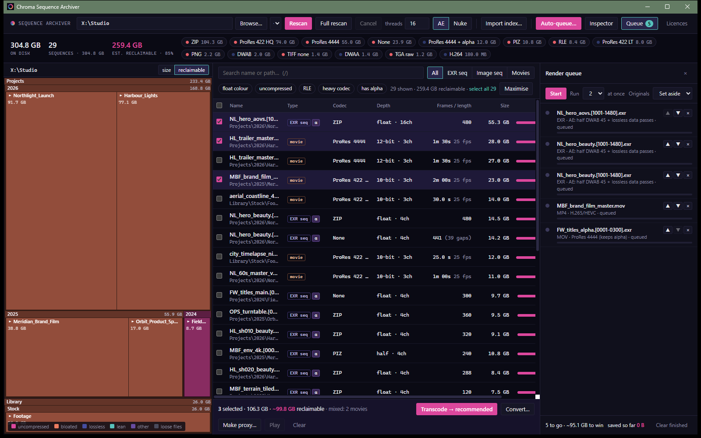

# Chroma Sequence Archiver

Free desktop app from [Chroma Studios](https://chroma.london) for shrinking render storage. Point it at a NAS, a
LucidLink volume or a local drive. It finds image sequences and movies, ranks the worst offenders, and converts them
in a render queue:

- EXR to DWAB/DWAA/ZIP, tuned for After Effects or Nuke, with data passes kept lossless
- heavy ProRes to MP4 (H.264/HEVC) or ProRes LT/Proxy/4444
- QuickTime proxies

Originals are set aside and can be restored with undo.

**Download:** see [Releases](https://github.com/jameslashmar/Chroma-Sequence-Archiver-releases/releases/latest), or the
[download page](https://jameslashmar.github.io/Chroma-Sequence-Archiver-releases/).

- **Windows 10/11 (64-bit):** `-setup.exe` or `.msi`, signed by Chroma Studios Ltd.
- **macOS (Apple silicon):** `.dmg`, signed with a Developer ID and notarised.

This repository holds only the release downloads and the download page. The app's source is not public.

## Third-party software

The app runs [OpenImageIO](https://github.com/AcademySoftwareFoundation/OpenImageIO) (`oiiotool`, Apache-2.0) and an
LGPL build of [FFmpeg](https://ffmpeg.org) as separate programs. Each release lists every licence in
`THIRD_PARTY_NOTICES.txt`. It also includes `ffmpeg-source-<version>.zip`, which holds the complete FFmpeg source and the
build scripts for the shipped binaries. Bugs and questions: info@chroma.london
